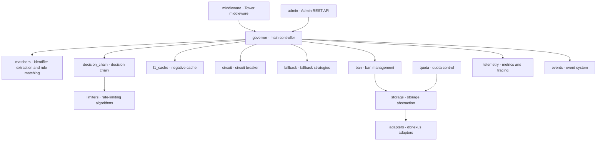
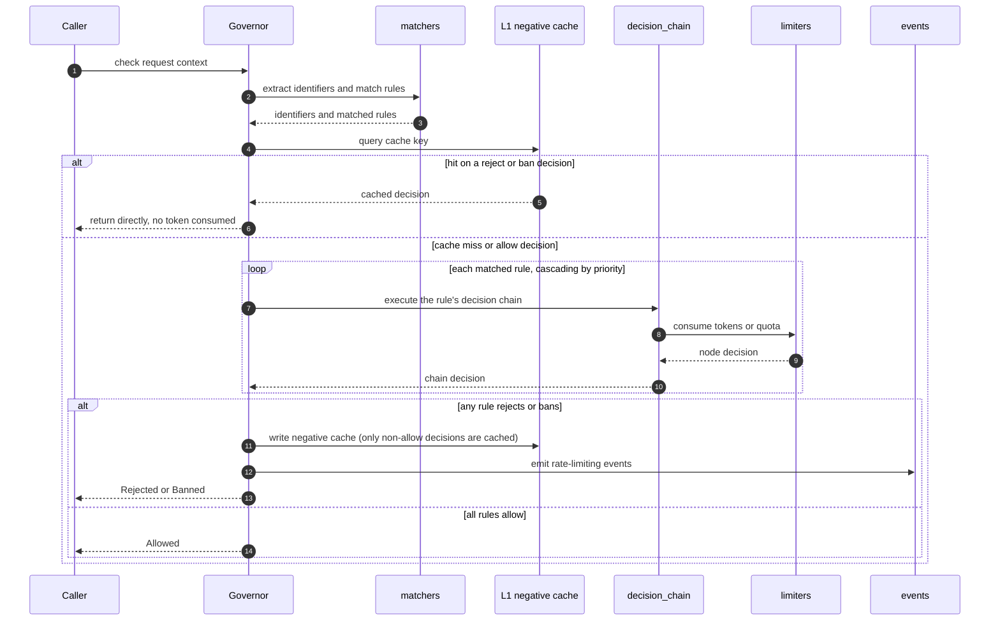
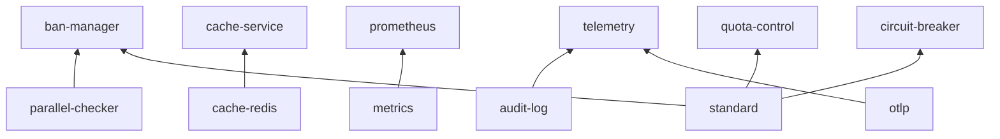

# 🏗️ Limiteron Architecture

This document describes Limiteron's overall architecture, module layout, and extension mechanisms, helping readers understand the framework's internals. Module facts are governed by the `src/` sources; for API details see the [API Reference](API_REFERENCE.md).

[🏠 Home](../../README.md) • [📋 Changelog](../CHANGELOG.md) • [🧪 Testing Guide](TESTING.md) • [🔒 Security](SECURITY.md)

---

## 📋 Table of Contents

📑 Table of Contents

- [🏛️ Overall Architecture](#️-overall-architecture)
- [🎯 Core Decision Flow](#-core-decision-flow)
- [🧱 Module Responsibilities](#-module-responsibilities)
- [💾 Storage and Cache](#-storage-and-cache)
- [🧩 Feature Dependency Overview](#-feature-dependency-overview)
- [🔌 Extension Mechanisms](#-extension-mechanisms)
- [🔗 Ecosystem and Integrations](#-ecosystem-and-integrations)

---

## 🏛️ Overall Architecture

Limiteron adopts a layered architecture: the access layer (Tower middleware, Admin API) hands traffic to the **Governor** main controller; the Governor extracts identifiers and matches rules via **matchers**, then executes the per-rule **decision_chain** in cascade, whose nodes are rate-limiting algorithm instances from **limiters**; bans, quotas, circuit breaking, and fallback participate in decisions as domain components; state lands through the **storage** abstraction — in-memory by default, switchable in production to dbnexus (PostgreSQL / SQLite / MySQL) persistence provided by **adapters**; **telemetry** and **events** provide metrics, tracing, and event egress.

---

## 🎯 Core Decision Flow

The complete decision path of a single `Governor::check(context)` call (distilled from `src/governor.rs`):

Key semantics (all traceable in the sources):

- **Rule matching is computed exactly once**; the matched rules carry through the whole check flow
- **Negative cache is fail-closed**: only reject/ban decisions enter the L1 cache; "allow" decisions are never cached, so every request genuinely executes the rate-limiting checks
- **Cascaded execution**: any rule rejecting means rejection; only all-allow passes
- When `parallel-checker` is enabled, ban checks run before the cache read, so banned identifiers cannot bypass checks via the cache

---

## 🧱 Module Responsibilities

| Module | Path | Responsibility |
|------|------|------|
| Governor | `src/governor.rs` | Main controller: identifier extraction, rule matching, cascaded decisions, statistics and introspection |
| Limiters | `src/limiters/` | Token bucket, leaky bucket, sliding/sharded-sliding/sliding-window-log/fixed window, concurrency, GCRA, HTB, AIMD adaptive, quota limiter, batch token prefetch |
| Matchers | `src/matchers/` | Identifier extractors, rule matching engine, custom matcher registry |
| DecisionChain | `src/decision_chain/` | Priority-cascaded responsibility chain and chain-level statistics |
| Ban | `src/ban/` | Ban types, YAML file loading with hot reload |
| Quota | `src/quota/` | Quota controller and periodic windows |
| Circuit | `src/circuit/` | Circuit breaker (Closed / Open / HalfOpen state machine) |
| Fallback | `src/fallback.rs` | Fallback strategy manager |
| Bulkhead | `src/bulkhead.rs` | Bulkhead isolation: per-resource-group pools with independent concurrency budgets (the `bulkhead` feature) |
| Storage | `src/storage/` | `Storage` / `BanStorage` / `QuotaStorage` traits, in-memory implementation, parallel ban checker |
| Adapters | `src/adapters/` | dbnexus storage adapters and `StorageFactory` (DSN-based creation) |
| Cache | `src/cache/` | oxcache unified cache service |
| L1 Cache | `src/l1_cache.rs` | Negative cache: caches only reject/ban decisions |
| Events | `src/events/` | Event emit/dispatch, Outbox, Webhook signing, ban synchronization |
| Middleware | `src/middleware/` | Tower Layer / Service, rate-limit response headers |
| Admin | `src/admin/` | Admin REST API server, RBAC, K8s probes |
| Telemetry | `src/telemetry/` | Prometheus metrics, OTLP export |
| Logging | `src/logging/` | Audit log (HMAC chained signatures) and log redaction |
| Validation | `src/validation.rs` | IP / user ID / MAC / API Key input validation (the `validation` feature) |
| Config | `src/config/` | `FlowControlConfig`, `ConfigBuilder`, `ConfigLoader` |
| Macros | `macros/`, `src/macros.rs` | `#[flow_control]` declarative macro (the `macros` feature) |
| Integrations | `src/integrations/` | dbnexus / oxcache / trait-kit / confers port implementations |
| Tenant | `src/tenant/` | Multi-tenant composite decision keys (the `multi-tenant` feature) |

---

## 💾 Storage and Cache

| Backend | Module | Features | Notes |
|------|------|------|------|
| MemoryStorage | `src/storage/storage_impl.rs` | always available | In-memory storage implementing `Storage` / `BanStorage` / `QuotaStorage` at once; ideal for single-node development and testing |
| dbnexus adapters | `src/adapters/` | `postgres` / `sqlite` / `mysql` (mutually exclusive) | Persistence via dbnexus; `StorageFactory` creates from a DSN |
| oxcache cache | `src/cache/` | `cache-service` / `cache-redis` | Unified cache service; the Redis backend connects via oxcache |
| Redis Lua atomic operations | `src/oxcache_lua.rs` | `lua-script` | Token-bucket/sliding-window/fixed-window/quota scripts execute atomically via oxcache `eval_lua`, supporting distributed rate limiting |

> **Note**: `RedisStorage` and the `redis-storage` feature were removed in v0.2.1; caching is managed uniformly via oxcache. The three dbnexus drivers `postgres` / `sqlite` / `mysql` are mutually exclusive and cannot coexist in one build.

---

## 🧩 Feature Dependency Overview

The feature system is organized by category (for the full list see the `[features]` section of [Cargo.toml](../../Cargo.toml) and [Feature Flags](USER_GUIDE.md#-feature-flags)):

| Category | Representative features | Notes |
|------|---------|------|
| Presets | `minimal` / `standard` / `full` | minimal is `default = []` (no external storage dependencies); presets exclude storage backends — persistence requires adding `postgres` / `sqlite` / `mysql` yourself |
| Storage | `postgres` / `sqlite` / `mysql` | dbnexus drivers, mutually exclusive |
| Cache | `cache-service` / `cache-redis` / `lua-script` | oxcache integration (`cache-storage` is a compatibility alias of `cache-redis`) |
| Algorithms | `gcra` / `adaptive-limiting` | GCRA rate limiting, AIMD adaptive concurrency |
| Security | `log-redaction` / `validation` | redaction, input validation |
| Observability | `telemetry` / `prometheus` / `metrics` / `audit-log` / `otlp` | metrics, tracing, audit; `metrics` implies `prometheus`, `audit-log` / `otlp` imply `telemetry` (`prometheus` keeps the old name `monitoring` as a compatibility alias) |
| Control plane | `admin-api` / `cli` | Admin REST API and `limiteron-cli` |
| Events | `event-system` / `webhook` / `ban-sync` | event subscription and Outbox; `webhook` signed egress and `ban-sync` cross-instance broadcast need to be combined with `event-system` |
| Ecosystem | `kit` / `i18n` / `config-confers`(-reload) | trait-kit, ICU4X, confers integrations; structured logging is provided directly by inklog (applications call `inklog::init_inklog_logger()`), and the redaction engine is introduced via the inklog dependency with the `log-redaction` feature |

---

## 🔌 Extension Mechanisms

| Extension point | Mechanism | Notes |
|--------|------|------|
| Custom rate-limiting algorithm | implement the `Limiter` trait | `allow` / `peek` / `remaining` / `check`; the decision chain and middleware use it uniformly |
| Custom matcher | implement the `CustomMatcher` trait | registered via `CustomMatcherRegistry`; supports Header / time-window combinations |
| Custom storage backend | implement `Storage` / `BanStorage` / `QuotaStorage` | injected as `Arc<dyn Trait>`; the in-memory implementation serves as a reference |
| Custom extractor | implement the `IdentifierExtractor` trait | joins `CompositeExtractor` for identifier extraction |
| Authorization | implement the `AuthorizationProvider` trait | hooks into the ban-management write-operation authorization chain |
| Events | `EventEmitter` / `EventHandler` | event subscription, Transactional Outbox, Webhook egress (HMAC signatures) |
| Declarative integration | the `#[flow_control]` macro | parameters like `rate` / `quota` / `concurrency` / `on_exceed` / `key_prefix`, generating rate-limiting wrappers at compile time |
| Config hot update | `POST /api/v1/config` | atomic config swap: rebuilds rule matchers and decision chains synchronously, invalidates the L1 cache and records history; `config-watcher` provides file-watching hot reload |
| Distributed | the `DistributedLimiter` trait | in-memory implementation out of the box; the Redis implementation coordinates across instances via Lua scripts (`distributed` + `lua-script`) |

---

## 🔗 Ecosystem and Integrations

Structured logging is provided directly by its canonical crate [inklog](https://github.com/Kirky-X/inklog) — limiteron no longer forwards an initialization entry point: the application layer depends on inklog directly and calls `inklog::init_inklog_logger()` (or `inklog::init_inklog_logger_with_config(config)`) to install the global subscriber; limiteron's own `log::`/`tracing::` calls then route into inklog's sink.

The `i18n` feature additionally integrates [ICU4X](https://github.com/unicode-org/icu4x) for locale-aware formatting — the formatting layer and message catalog registration are uniformly delegated to the trait-kit i18n base (ICU4X is pulled in by trait-kit; this repo does not own icu dependencies directly; message catalogs are registered via the sdforge::i18n registry host, with FTL files remaining the source of truth).

The workspace member [`integrations/limiteron-sdforge`](../../integrations/limiteron-sdforge/) provides a protection layer in the reverse direction: the limiteron side exposes rate limiting / circuit breaking / banning to sdforge applications as a three-state `Guard` decision surface (adapted as `ForgeRateLimiter` under that crate's own sdforge feature), opposite in consumption direction to sdforge's existing adapters and independently versioned.

The workspace member [`integrations/limiteron-dbnexus`](../../integrations/limiteron-dbnexus/) provides a rate-limiting port adapter for dbnexus: it implements the `dbnexus-limiter-port` port extracted in dbnexus 0.6.0-rc.6 (`Limiter::check(key)`), internally deciding per-key token buckets via `LimiterManager` (deny carries `Retry-After`, backend failures are reported explicitly, and fail-open/closed is decided by the consumer) — dbnexus applications inject it via `RateLimitBackend::External` at the composition root; like the sdforge bridge it is not published to crates.io and its release cadence follows the limiteron main repo.
