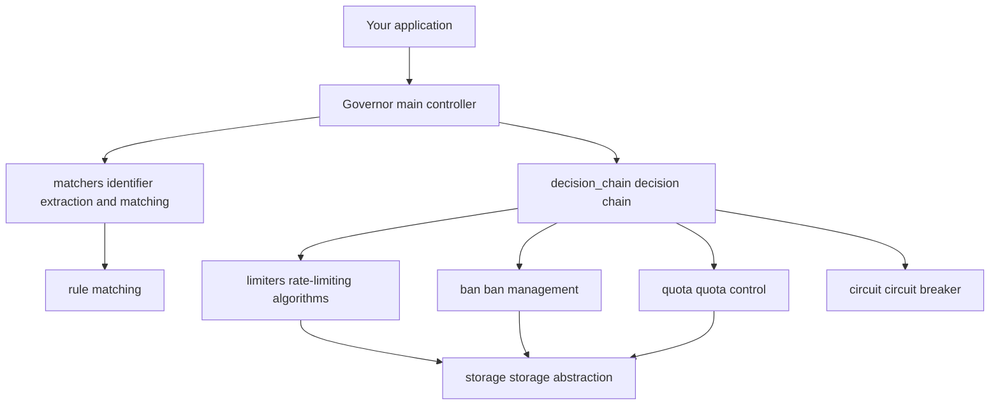

# 📖 Limiteron User Guide

This guide is the complete usage tutorial for Limiteron (a unified flow-control framework for Rust), covering everything from installation and core concepts to advanced usage, best practices, and troubleshooting. For a quick overview see the [README](../../README.md); for API details see the [API Reference](API_REFERENCE.md).

[🏠 Home](../../README.md) • [💻 Examples](../../examples/) • [❓ FAQ](FAQ.md)

---

## 📋 Table of Contents

<details open>
<summary>📑 Table of Contents</summary>

- [✨ Introduction](#-introduction)
- [🚀 Quick Start](#-quick-start)
  - [Prerequisites](#prerequisites)
  - [Installation](#installation)
  - [First Step](#first-step)
- [🧩 Core Concepts](#-core-concepts)
- [📖 Basic Usage](#-basic-usage)
  - [Initialization](#initialization)
  - [Configuration](#configuration)
  - [Basic Operations](#basic-operations)
- [⚙️ Advanced Usage](#️-advanced-usage)
  - [Programmatic Configuration](#programmatic-configuration)
  - [L1 Negative Cache Tuning](#l1-negative-cache-tuning)
  - [Performance Benchmarks](#performance-benchmarks)
  - [Error Handling](#error-handling)
- [🌟 Best Practices](#-best-practices)
- [🔁 Common Patterns](#-common-patterns)
- [🔧 Troubleshooting](#-troubleshooting)
- [🗺️ Next Steps](#️-next-steps)
- [🧩 Feature Flags](#-feature-flags)

</details>

---

## ✨ Introduction

**Limiteron** is a unified flow-control framework for Rust that helps you protect applications against abuse and traffic spikes. This guide takes you from basic setup to advanced usage patterns.

| You will learn | Content |
|---------|------|
| 🚀 Quick start | integrate your first limiter in 5 minutes |
| ⚙️ Configuration | programmatic building and TOML file loading |
| 🌟 Best practices | initialization, instance sharing, and error handling |
| 🔧 Advanced topics | decision chains, ban file loading, and the Admin API |

> 💡 **Tip**: this guide assumes basic knowledge of Rust async programming (`tokio`, `async/await`).

---

## 🚀 Quick Start

### Prerequisites

Before starting, make sure you have the following installed:

| Category | Items |
|------|------|
| Required | Rust 1.97.1+ (pinned by [rust-toolchain.toml](../../rust-toolchain.toml)), Cargo, Git |
| Optional | A Rust-capable IDE, Docker (containerized deployment), PostgreSQL / MySQL / SQLite (persistence via dbnexus), Redis (cache integration via oxcache) |

<details>
<summary><b>🔍 Verify your installation</b></summary>

```bash
# Check the Rust version
rustc --version
# Expected: rustc 1.97.1 or higher

# Check the Cargo version
cargo --version

# Check the Git version
git --version
```

</details>

### Installation

```bash
cargo add limiteron --features macros
```

Or add it manually in `Cargo.toml` (the version matches the current release line of [Cargo.toml](../../Cargo.toml)):

```toml
[dependencies]
limiteron = { version = "0.3", features = ["macros"] }
```

<details>
<summary><b>🌐 Other installation options</b></summary>

**Enable features on demand**

```toml
[dependencies]
limiteron = { version = "0.3", features = ["sqlite", "ban-manager"] }
```

> ⚠️ The three storage drivers `postgres` / `sqlite` / `mysql` are mutually exclusive; do not use `--all-features`, use explicit feature combinations instead. The default feature set is empty (`default = []`) — core rate limiting has zero external storage dependencies.

**Local path dependency**

```toml
[dependencies]
limiteron = { path = "/path/to/limiteron" }
```

</details>

### First Step

Verify the installation with a minimal example (mirroring the repo example [`simple_rate_limit.rs`](../../examples/src/bin/simple_rate_limit.rs)):

```rust
use limiteron::limiters::{Limiter, TokenBucketLimiter};

#[tokio::main]
async fn main() -> Result<(), Box<dyn std::error::Error>> {
    // Capacity 10, 1 token refilled per second
    let limiter = TokenBucketLimiter::new(10, 1);

    match limiter.allow(1).await {
        Ok(true) => println!("✅ Limiteron is ready"),
        Ok(false) => println!("❌ request rate-limited"),
        Err(e) => println!("❌ error: {:?}", e),
    }

    Ok(())
}
```

<details>
<summary><b>🎬 Run steps</b></summary>

```bash
# Create a new project
cargo new hello-limiteron
cd hello-limiteron

# Add the dependency
cargo add limiteron

# Copy the code above into src/main.rs, then run
cargo run
```

**Expected output:**

```text
✅ Limiteron is ready
```

</details>

---

## 🧩 Core Concepts

Understanding these core concepts will help you use the library effectively.



### 1️⃣ Rate Limiters

**What**: components that control request rates; all implement the unified `Limiter` trait.

**Why it matters**: they protect downstream services at a fixed cost, forming the first line of defense for traffic governance.

```rust
use limiteron::limiters::{Limiter, TokenBucketLimiter};

let limiter = TokenBucketLimiter::new(10, 1); // 10 tokens, 1 refilled per second
limiter.check("user123").await?;
```

<details>
<summary><b>📚 Learn more</b></summary>

Rate-limiting algorithms provided by `src/limiters/`:

| Algorithm | Type | Applicable scenarios |
|------|------|---------|
| Token bucket | `TokenBucketLimiter` | allows some burst while the long-term rate stays controlled |
| Leaky bucket | `LeakyBucketLimiter` | water-level accounting with burst capacity + sustained drain rate; the dual of the token bucket (water level = capacity − tokens); a lock-guarded single point serializes, prefer the token bucket under high contention |
| Sliding window | `SlidingWindowLimiter` (deprecated re-export) | exact window counting |
| Sharded sliding window | `ShardedSlidingWindowLimiter` | exact window counting under high concurrency |
| Sliding window log | `SlidingWindowLogLimiter` | exact sliding window without boundary spikes; costs O(requests in window) memory (16B per entry, 100K cap) — prefer the sharded sliding window for large quotas and long windows |
| Fixed window | `FixedWindowLimiter` | simplest implementation, highest throughput |
| Concurrency control | `ConcurrencyLimiter` | limits the number of concurrently processed requests |
| GCRA | `GcraLimiter` (the `gcra` feature) | cell-rate algorithm, smooth rate limiting |
| HTB hierarchical token bucket | `HierarchicalTokenBucket` | parent-child bandwidth borrowing, class-based rate limiting |
| AIMD adaptive | `AdaptiveConcurrencyLimiter` (the `adaptive-limiting` feature) | adjusts the window from latency/error-rate feedback |

</details>

### 2️⃣ Ban Management

**What**: manages bans of malicious users, IPs, and regions.

**Key features:**

- IP / user ID / MAC target bans and CIDR range bans
- Geo location bans (by country code, ISO 3166-1 alpha-2)
- Ban priority system (IP highest)
- Automatic ban durations with exponential backoff
- Bulk loading from YAML files with hot reload (the `config-watcher` feature)

```rust
use limiteron::adapters::StorageFactory;
use limiteron::ban::{BanManager, BanManagerConfig, BanSource, BanTarget};
use std::time::Duration;

let mut factory = StorageFactory::from_dsn("postgresql://localhost/limiteron");
factory.initialize(None).await?;
let ban_storage = factory.create_ban_storage().await?;
let ban_manager = BanManager::with_dependencies(ban_storage, BanManagerConfig::default()).await?;

// IP ban
let ip_target = BanTarget::Ip("192.168.1.100".to_string());
ban_manager.create_ban(
    ip_target,
    "malicious request".to_string(),
    BanSource::Manual { operator: "admin".to_string() },
    serde_json::json!({}),
    Some(Duration::from_secs(3600)),
).await?;

// Geo ban (by country code)
let geo_target = BanTarget::Geo { country_code: "CN".to_string() };
ban_manager.create_ban(
    geo_target,
    "regional ban".to_string(),
    BanSource::Manual { operator: "admin".to_string() },
    serde_json::json!({}),
    None, // None means the duration is computed automatically by the backoff algorithm
).await?;
```

<details>
<summary><b>📚 BanTarget type details</b></summary>

`BanTarget` supports 5 ban-target variants, serialized by serde as `{"type":"...","value":...}`:

| Variant | serde type | value format | Example |
|------|-----------|-----------|------|
| `Ip(String)` | `"ip"` | IP string | `{"type":"ip","value":"192.168.1.1"}` |
| `UserId(String)` | `"user"` | user ID | `{"type":"user","value":"user123"}` |
| `Mac(String)` | `"mac"` | MAC address | `{"type":"mac","value":"00:1a:2b:3c:4d:5e"}` |
| `Geo { country_code }` | `"geo"` | object | `{"type":"geo","value":{"country_code":"CN"}}` |
| `Cidr(String)` | `"cidr"` | CIDR string | `{"type":"cidr","value":"10.0.0.0/8"}` |

> **Note**: the Geo `country_code` must be an uppercase 2-letter ISO 3166-1 alpha-2 code (such as `"CN"`, `"US"`); lowercase or non-2-letter values trigger a `ValidationError`. CIDR query semantics: when an exact IP match misses, range ban records are matched by longest prefix.

</details>

### 3️⃣ Quota Control

**What**: limits total consumption within a specific time window.

```rust
use limiteron::quota::{QuotaConfig, QuotaController};

let config = QuotaConfig {
    limit: 10000,
    window_size: 60, // window size (seconds)
    ..Default::default()
};
let quota = QuotaController::builder().with_config(config).build()?;

match quota.consume("user123", "api_resource", 1).await {
    Ok(result) => println!("remaining quota: {}", result.remaining),
    Err(e) => println!("quota consumption failed: {}", e),
}
```

---

## 📖 Basic Usage

### Initialization

Every application needs to initialize storage and the Governor before use:

```rust
use limiteron::Governor;
use limiteron::adapters::StorageFactory;

#[tokio::main]
async fn main() -> Result<(), Box<dyn std::error::Error>> {
    // Option 1: minimal initialization (default in-memory storage, out of the box)
    let governor = Governor::new().await?;

    // Option 2: builder pattern, injecting persistent storage
    let mut factory = StorageFactory::from_dsn("postgresql://localhost/limiteron");
    factory.initialize(None).await?;
    let storage = factory.create_storage().await?;
    let ban_storage = factory.create_ban_storage().await?;

    let governor = Governor::builder()
        .with_storage(storage)
        .with_ban_storage(ban_storage)
        .build()
        .await?;

    Ok(())
}
```

| Option | Use case | Complexity |
|------|---------|--------|
| `Governor::new()` | quick start, development and testing | 🟢 simple |
| `Governor::builder()` | production, custom storage and observability components | 🟡 medium |

### Configuration

Limiteron supports two configuration methods: **programmatic building** (`ConfigBuilder`) and **TOML file loading** (`ConfigLoader`, with environment-variable overrides; see [API Reference](API_REFERENCE.md#️-configuration-loading)).

```rust
use limiteron::config::{ConfigBuilder, StorageType};

// Programmatic building: at least one rule, and each rule needs matchers and limiters
let config = ConfigBuilder::new()
    .with_storage(StorageType::Memory)
    .with_rule(|rule| {
        rule.id("api_limit")
            .name("API rate limit")
            .priority(100)
            .user_matcher(vec!["user123".to_string()])
            .token_bucket(100, 10)
    })
    .build()?;

// After building, inject via Governor::builder().with_config(config)
```

<details>
<summary><b>⚙️ Core config file fields</b></summary>

| Field | Type | Default | Description |
|------|------|--------|------|
| `version` | String | `"0.1.0"` | config version |
| `global.storage` | `StorageType` | `Memory` | storage backend (memory / postgresql / redis) |
| `global.cache` | `CacheBackend` | `Memory` | cache backend (memory / redis / none) |
| `global.metrics` | `MetricsBackend` | `Prometheus` | metrics backend (prometheus / statsd / none) |
| `global.trusted_proxies` | `TrustedProxyConfig` | off | trusted proxy configuration (secure client-IP extraction) |
| `rules` | `Vec<Rule>` | `[]` | rate-limiting rule list (each with id / name / priority / matchers / limiters) |

</details>

### Basic Operations

| Operation | Entry point | Description |
|------|------|------|
| Rate-limit check | `Limiter::allow(cost)` | consumes tokens/quota and returns a boolean decision |
| Request-context check | `Governor::check(&RequestContext)` | identifier extraction, rule matching, cascaded decisions |
| Ban management | `BanManager::create_ban` / `is_banned` / `delete_ban` | ban lifecycle |
| Quota consumption | `QuotaController::consume` | consume quota per user and resource |
| Circuit state | `CircuitBreaker::get_state()` | query the circuit breaker's current state |

```rust
// Rate-limit check
let limiter = TokenBucketLimiter::new(10, 1);
match limiter.allow(1).await {
    Ok(true) => println!("✅ allowed"),
    Ok(false) => println!("❌ rejected"),
    Err(e) => println!("❌ error: {:?}", e),
}
```

```rust
// Unban a user
ban_manager.delete_ban(&BanTarget::UserId("user123".to_string()), "admin".to_string()).await?;
```

```rust
// Quota consumption
quota.consume("user123", "api_resource", 1).await?;
```

```rust
// Circuit state
let state = breaker.get_state().await;
println!("circuit breaker state: {:?}", state);
```

<details>
<summary><b>🎯 Full example: Governor decision</b></summary>

```rust
use limiteron::adapters::StorageFactory;
use limiteron::error::Decision;
use limiteron::matchers::RequestContext;

#[tokio::main]
async fn main() -> Result<(), Box<dyn std::error::Error>> {
    let mut factory = StorageFactory::from_dsn("postgresql://localhost/limiteron");
    factory.initialize(None).await?;
    let storage = factory.create_storage().await?;
    let ban_storage = factory.create_ban_storage().await?;

    let governor = Governor::builder()
        .with_storage(storage)
        .with_ban_storage(ban_storage)
        .build()
        .await?;

    // Build the request context (identifiers extracted from headers)
    let context = RequestContext::new()
        .with_header("X-User-Id", "user123")
        .with_path("/api/v1/users")
        .with_method("GET");

    let decision = governor.check(&context).await?;
    match decision {
        Decision::Allowed(meta) => {
            println!("✅ request allowed, remaining: {}", meta.remaining);
        }
        Decision::Rejected(meta) => {
            println!("❌ request rejected: {}, retry in {} seconds", meta.reason, meta.retry_after);
        }
        Decision::Banned(info) => {
            println!("❌ request banned: {}", info.reason());
        }
    }

    Ok(())
}
```

</details>

---

## ⚙️ Advanced Usage

### Programmatic Configuration

In production, rules are usually loaded from a TOML file (`ConfigLoader::load_from_file_with_env` supports environment-variable overrides); in dynamic scenarios you can also build programmatically and inject via `Governor::builder().with_config(...)`, or hot-update via `POST /api/v1/config` (see [API Reference](API_REFERENCE.md#-admin-rest-api)).

<details>
<summary><b>🎛️ Performance configuration trade-offs</b></summary>

| Orientation | Use case | Throughput | Latency | Memory |
|------|---------|--------|------|------|
| Low latency | real-time applications | medium | ⚡ very low | high |
| High throughput | batch processing | ⚡ very high | medium | medium |
| Balanced | general | high | low | medium |
| Low memory | resource-constrained | low | medium | ⚡ very low |

</details>

### L1 Negative Cache Tuning

The Governor ships an L1 negative cache: **only reject/ban decisions are cached**; "allow" decisions never enter the cache, so every request genuinely executes the rate-limit and ban checks. Cache behavior is adjustable via the builder:

```rust
use limiteron::l1_cache::L1CacheConfig;
use limiteron::Governor;
use std::time::Duration;

let governor = Governor::builder()
    .with_l1_cache_enabled(true)
    // default TTL 60 seconds, max 1000 entries
    .with_l1_cache_config(L1CacheConfig::new(Duration::from_secs(60), 1000))
    .build()
    .await?;
```

Lowering the cache entry cap reduces the cache's memory footprint.

### Performance Benchmarks

Throughput and latency benchmark numbers (TokenBucket 12M+ ops/s / P99 < 1µs, FixedWindow 20M+ ops/s, etc., measured 2026-01-19) are in [README Performance](../../README.md#-performance). Test environment: Linux WSL2, Release optimization mode.

#### Concurrency Tests

| Test item | Result | Status |
|---------|------|------|
| Serial vs concurrent consistency | difference 0 | ✅ pass |
| High-concurrency stability | 50/100 concurrency | ✅ pass |
| Rate-limit correctness | 100% consistent | ✅ pass |

<details>
<summary><b>📊 Detailed test data</b></summary>

```text
Functional test results:
  TokenBucket        - pass (3µs)
  SlidingWindow      - pass (2µs)
  FixedWindow        - pass (3µs)
  ConcurrencyLimiter - pass (51ms)
  MemoryStorage      - pass (8µs)
  CircuitBreaker     - pass (1.3s)

Concurrency test results:
  Serial execution           - 34,540,883 ops/s
  Concurrent execution       - 17,646,145 ops/s
  Data consistency           - 100%
```

</details>

Reproduce with: `cargo bench --features full` (benchmark infrastructure in [README](../../README.md#-performance)).

### Error Handling

```rust
use limiteron::error::LimiteronError;

async fn handle_request(limiter: &limiteron::limiters::TokenBucketLimiter) {
    match limiter.allow(1).await {
        Ok(true) => println!("✅ request allowed"),
        Ok(false) => println!("⚠️ request rate-limited"),
        Err(LimiteronError::LimitError(msg)) => {
            println!("⚠️ rate-limit error: {}", msg);
        }
        Err(LimiteronError::BanError(msg)) => {
            eprintln!("❌ banned: {}", msg);
        }
        Err(e) => {
            eprintln!("❌ error: {:?}", e);
        }
    }
}
```

<details>
<summary><b>📋 Common error types</b></summary>

| Error type | Description | Recovery strategy |
|----------|------|---------|
| `LimitError` | rate-limit error | wait and retry |
| `RateLimitExceeded` | rate limit exceeded | wait and retry |
| `QuotaExceeded` | quota exceeded | wait for the next time window |
| `ConcurrencyLimitExceeded` | concurrency limit exceeded | wait for occupancy release |
| `Throttled` | macro throttle queue timeout | retry later |
| `BanError` | banned | contact the administrator |
| `CircuitBreakerError` | circuit breaker open | wait for recovery |
| `ValidationError` | invalid input | fix the input |
| `ConfigError` | configuration error | check the configuration |

For the full variant list see [API Reference](API_REFERENCE.md#-error-handling).

</details>

---

## 🌟 Best Practices

### ✅ Recommended

| Practice | Description |
|------|------|
| **Initialize early** | create storage and the Governor at application startup, avoiding cold-start overhead on the request path |
| **Share limiter instances** | all limiters and the Governor are `Send + Sync`; reuse the same instance across requests — creating instances inside a loop defeats rate limiting |
| **Handle errors correctly** | `allow()` returning `Ok(false)` means rate-limited; return a 429-style response instead of silently swallowing it |
| **Use the macro for simpler integration** | the `#[flow_control]` declarative macro generates rate-limiting wrapper code automatically |

```rust
// Use LazyLock to guarantee one globally shared limiter instance
use limiteron::limiters::TokenBucketLimiter;
use std::sync::LazyLock;

static LIMITER: LazyLock<TokenBucketLimiter> = LazyLock::new(|| TokenBucketLimiter::new(10, 1));
```

```rust
use limiteron::flow_control;

#[flow_control(rate = "100/s")]
async fn api_handler(user_id: &str) -> Result<String, limiteron::error::LimiteronError> {
    // the macro handles rate limiting automatically
    Ok("Success".to_string())
}
```

### ❌ Avoid

```rust
// ❌ Bad: ignoring the check result
let _ = limiter.check(key).await;

// ✅ Good: propagate or handle explicitly
limiter.check(key).await?;
```

```rust
// ❌ Bad: creating a limiter inside the loop — every iteration gets a brand-new bucket
for request in requests {
    let limiter = TokenBucketLimiter::new(10, 1);
    limiter.check(key).await?;
}

// ✅ Good: hoist the instance out of the loop
let limiter = TokenBucketLimiter::new(10, 1);
for request in requests {
    limiter.check(key).await?;
}
```

### 💡 Tips and Tricks

> **🔥 Performance tip**: build with release mode in production.
>
> ```bash
> cargo build --release
> ```

> **🔒 Security tip**: never hard-code database connection strings or keys in code; inject them via environment variables; enable the `log-redaction` and `audit-log` features to protect sensitive data. For the security design see the [Security document](SECURITY.md).

> **📊 Observability tip**: after enabling the `prometheus` (old name `monitoring`) / `metrics` features, the Governor's allow / reject / ban metrics are wired into Prometheus automatically.

---

## 🔁 Common Patterns

### Pattern 1: API Protection

```rust
use limiteron::flow_control;

#[flow_control(rate = "100/s", quota = "10000/m", concurrency = 50)]
async fn api_handler(user_id: &str) -> Result<String, limiteron::error::LimiteronError> {
    Ok(format!("processed request for user {}", user_id))
}
```

### Pattern 2: Bulk Ban Loading from a YAML File (BanFileLoader)

```rust
use limiteron::ban::{BanFileLoader, BanManager};

let mut ban_manager = BanManager::new().await?;
let loader = BanFileLoader::new("config/bans.yaml");

// One-shot load (a single failed entry does not abort the whole load)
let result = loader.load_once(&ban_manager).await?;
println!("loaded {} entries successfully, {} failed", result.success_count, result.failure_count);
for err in &result.errors {
    eprintln!("failed: {} - {}", err.target_desc, err.error);
}

// Enable file-change hot reload (requires the `config-watcher` feature, 500ms debounce)
loader.start_watching(ban_manager.clone()).await?;

// Stop watching (the loader also stops automatically when dropped)
loader.stop_watching().await;
```

**YAML file format** (`config/bans.yaml`):

```yaml
bans:
  - target:
      type: ip
      value: "192.168.1.1"
    reason: "malicious request"
    duration_secs: 3600  # optional, null = use the backoff algorithm
  - target:
      type: geo
      value:
        country_code: "CN"
    reason: "regional ban"
    # duration_secs omitted = computed automatically by the backoff algorithm
  - target:
      type: user
      value: "abuser123"
    reason: "abusive behavior"
    duration_secs: null
```

> **Security note**: BanFileLoader has built-in YAML-bomb protection with a 2MB file-size cap; exceeding it returns `ConfigError`.

### Pattern 3: Composing Multiple Limiters with a Decision Chain

```rust
use limiteron::decision_chain::{DecisionChain, DecisionNode};
use limiteron::limiters::TokenBucketLimiter;
use std::sync::Arc;

let rate_node = DecisionNode::with_dependencies(
    "rate".to_string(),
    "rate limit".to_string(),
    Arc::new(TokenBucketLimiter::new(100, 10)),
    100, // priority; higher numbers are checked first
);
let quota_node = DecisionNode::with_dependencies(
    "quota".to_string(),
    "quota limit".to_string(),
    Arc::new(quota_limiter),
    90,
);

let chain = DecisionChain::builder()
    .add_node(rate_node)
    .add_node(quota_node)
    .build();

// Executes in priority cascade; any node rejecting means rejection
let decision = chain.check().await?;
```

### Pattern 4: Managing Bans via the Admin REST API

After enabling the `admin-api` feature, bans can be managed via HTTP endpoints. All endpoints require an `Authorization: Bearer <api_key>` header.

**Create a ban** (`POST /api/v1/ban`):

```bash
curl -X POST http://localhost:8080/api/v1/ban \
  -H "Authorization: Bearer your-api-key" \
  -H "Content-Type: application/json" \
  -d '{
    "target": {"type": "geo", "value": {"country_code": "CN"}},
    "reason": "regional ban",
    "operator": "admin-alice",
    "duration_secs": 3600
  }'
# returns 201 Created on success, with a body containing {id, ban_times, expires_at, is_manual}
```

Supported target types: `ip` / `user` / `mac` / `geo` / `cidr`. `operator` and `duration_secs` are optional (when omitted, `operator="admin-api"` and `duration_secs` uses the backoff algorithm).

**Remove a ban** (`DELETE /api/v1/ban/{target}`):

```bash
# Explicitly specify the type to unban MAC/Geo targets
curl -X DELETE "http://localhost:8080/api/v1/ban/CN?type=geo" \
  -H "Authorization: Bearer your-api-key" \
  -H "Content-Type: application/json" \
  -d '{"reason": "unban", "operator": "admin-alice"}'

# Without a type, inferred automatically (valid IP first, falling back to UserId)
curl -X DELETE "http://localhost:8080/api/v1/ban/192.168.1.1" \
  -H "Authorization: Bearer your-api-key"
```

For all endpoints and status codes see [API Reference](API_REFERENCE.md#-admin-rest-api).

---

### Pattern 5: Retry Backoff Cooperating with Upstream `Retry-After` (the `retry` feature)

When the upstream itself rate-limits, retries should not guess their own backoff — consume the wait duration the upstream provides, and cap retry traffic with `budget_ratio`,
so a downstream failure does not get amplified by a retry storm:

```rust
use limiteron::retry::{RetryDecision, RetryPolicy};
use std::time::Duration;

let policy = RetryPolicy::new(3, Duration::from_millis(200))
    .with_jitter(0.2)          // spread retry spikes (non-cryptographic pseudo-randomness)
    .with_budget_ratio(0.1);   // retries stay within 10% of total calls

let resp = policy
    .execute_with(
        || call_upstream(),
        |_attempt, err| match err {
            // upstream 429 carrying retry_after (or GCRA's retry_after_us): wait as instructed
            UpstreamError::RateLimited { retry_after } => {
                RetryDecision::RetryAfter(Duration::from_secs(*retry_after))
            }
            UpstreamError::Transient(_) => RetryDecision::Retry,
            // 4xx semantic errors are not retryable — short-circuit immediately
            _ => RetryDecision::Stop,
        },
    )
    .await?;
```

Key points: `RetryAfter` and `Retry` are accounted identically against the retry budget, but the **actual wait adds no jitter and is not capped by `max_delay`**
(capping would retry before the upstream-specified moment and earn the same 429 for nothing); the reasonableness (upper bound) of the instructed value is guarded by the decision callback.
If you only care whether a retry is possible without reading per-attempt wait durations, use the boolean classifier `execute(op, is_retryable)`;
to account for or alert on retry counts, use `execute_notify`'s `on_retry(attempt, err)` hook (called only for retries that actually happen).
When downstream already has a circuit breaker, switch to `execute_with_breaker`: during the open state it runs once only and injects no retry traffic into a downstream already judged faulty.

---

## 🔧 Troubleshooting

<details>
<summary><b>❓ Problem: rate limiting is not taking effect</b></summary>

**Cause**: a new limiter instance is created for every request, or the limiter instance is not shared across requests.

**Solution**:

```rust
use limiteron::limiters::TokenBucketLimiter;
use std::sync::LazyLock;

// Use a globally shared limiter instance
static LIMITER: LazyLock<TokenBucketLimiter> = LazyLock::new(|| TokenBucketLimiter::new(10, 1));

// Or use the macro
use limiteron::flow_control;

#[flow_control(rate = "10/s")]
async fn handler() -> Result<(), limiteron::error::LimiteronError> {
    Ok(())
}
```

</details>

<details>
<summary><b>❓ Problem: performance is slower than expected</b></summary>

**Diagnostic steps**:

1. Confirm running in release mode (`cargo run --release`)
2. Check whether limiters or storage instances are rebuilt per request
3. Check the storage backend: in-memory storage is fastest; persistent storage is affected by network and database

</details>

<details>
<summary><b>❓ Problem: memory usage is too high</b></summary>

**Solution**:

- Lower the L1 negative cache entry cap (the second argument of `L1CacheConfig::new`)
- The limiter manager ships LRU eviction (100,000-entry capacity), so malicious keys never accumulate unboundedly
- For persistence, check the database connection pool cap configuration

</details>

**Need more help?** [Open an issue](https://github.com/Kirky-X/limiteron/issues) or consult the [FAQ](FAQ.md).

---

## 🗺️ Next Steps

| Resource | Description |
|------|------|
| [💻 Examples](../../examples/) | 21 runnable examples covering all core capabilities |
| [📚 API Reference](API_REFERENCE.md) | signatures and semantics of all public APIs |
| [❓ FAQ](FAQ.md) | Q&A collected by topic |
| [🏗️ Architecture](ARCHITECTURE.md) | design concepts, module layout, and extension mechanisms |
| [🔒 Security](SECURITY.md) | security design and vulnerability reporting process |

---

## 🧩 Feature Flags

Limiteron enables no optional capabilities by default (`default = []`) — compose them on demand. The items below map one-to-one to the `[features]` section of [Cargo.toml](../../Cargo.toml):

**Feature presets**

| Preset | Description | Enabled features |
|------|------|------------|
| `minimal` | core rate limiting, no external storage dependencies | none |
| `standard` | core capabilities (bans / quotas / circuit breaking) | `ban-manager`, `quota-control`, `circuit-breaker` |
| `full` | all features except storage backends (excludes `cli`) | 36 features, see Cargo.toml |

> Note: presets never include storage backends; for persistence add `sqlite` / `postgres` / `mysql` yourself (dbnexus drivers are mutually exclusive — only one can be added per build).
>
> ⚠️ **File-backed SQLite deployment tip**: connection-level PRAGMAs such as WAL **cannot** be carried via the connection URL — sqlx 0.9's connection-string query-parameter allowlist only accepts `mode`/`cache`/`immutable`/`vfs`; parameters outside the allowlist (such as `journal_mode=WAL`) make the driver reject the connection outright. The correct approach is `StorageFactoryConfig::with_sqlite_pragmas` (requires the `sqlite` feature) passing dbnexus's `SqlitePragmas`; PRAGMAs are applied per connection at pool creation:
>
> ```rust
> use dbnexus::SqlitePragmas;
> use limiteron::adapters::{StorageFactory, StorageFactoryConfig};
>
> let config = StorageFactoryConfig::sqlite("data/limiteron.db?mode=rwc").with_sqlite_pragmas(
>     SqlitePragmas {
>         journal_mode: Some("WAL".to_string()),
>         busy_timeout_ms: Some(5_000),
>         ..Default::default()
>     },
> );
> ```
>
> Without configuration, busy_timeout falls back to sqlx's built-in default of 5s, but journal_mode remains SQLite's default delete mode — concurrent writes may hit `database is locked`.

<details>
<summary><b>📋 All features (by category)</b></summary>

<br>

<table>
<tr><th>Category</th><th>Feature</th><th>Description</th><th>Default</th></tr>
<tr><td rowspan="5">Storage backends</td><td><code>postgres</code></td><td>PostgreSQL storage (dbnexus server driver + sea-orm)</td><td>❌</td></tr>
<tr><td><code>sqlite</code></td><td>SQLite storage (dbnexus embedded driver, the local default backend; <code>StorageFactory::create_schema</code> auto-creates tables, the in-memory database <code>sqlite::memory:</code> is unit-tested and behavior-cross-checked against the Redis-shaped backend)</td><td>❌</td></tr>
<tr><td><code>mysql</code></td><td>MySQL storage (dbnexus server driver)</td><td>❌</td></tr>
<tr><td><code>cache-redis</code></td><td>Redis cache backend (via oxcache; formerly <code>cache-storage</code>, kept as a compatibility alias)</td><td>❌</td></tr>
<tr><td><code>lua-script</code></td><td>Redis Lua script execution (via oxcache <code>eval_lua</code>): seven scripts — sliding window / sliding window log (cost-weighted) / fixed window / token bucket / token bucket with burst overdraft / quota consumption and reset</td><td>❌</td></tr>
<tr><td rowspan="11">Core capabilities</td><td><code>ban-manager</code></td><td>Ban management (target bans, priorities, file loading)</td><td>❌</td></tr>
<tr><td><code>bulkhead</code></td><td>Bulkhead isolation: per-resource-group pools + independent concurrency budgets and isolation metrics</td><td>❌</td></tr>
<tr><td><code>quota-control</code></td><td>Quota control</td><td>❌</td></tr>
<tr><td><code>manager</code></td><td>Limiter manager (<code>LimiterManager</code> caches per key; the runtime counterpart of the <code>#[flow_control]</code> macro, can be enabled standalone)</td><td>❌</td></tr>
<tr><td><code>capacity-dial</code></td><td>Six-level capacity dialing (<code>DialLevel</code> L0-L5 / <code>DialThresholds</code> / <code>CapacityDial</code>, atomic interior mutability; not part of any preset)</td><td>❌</td></tr>
<tr><td><code>circuit-breaker</code></td><td>Circuit breaker</td><td>❌</td></tr>
<tr><td><code>retry</code></td><td>Retry primitive with backoff (<code>RetryPolicy</code>: exponential backoff + jitter + retry budget, complementing the circuit breaker — the breaker protects the downstream while retries absorb transient jitter; the <code>execute_with</code> decision callback can delay retries as instructed by the upstream)</td><td>❌</td></tr>
<tr><td><code>fallback</code></td><td>Fallback strategies (FallbackManager)</td><td>❌</td></tr>
<tr><td><code>custom-limiter</code></td><td>Custom limiter extension</td><td>❌</td></tr>
<tr><td><code>cache-service</code></td><td>Unified cache service (DI support)</td><td>❌</td></tr>
<tr><td><code>gcra</code></td><td>GCRA rate-limiting algorithm</td><td>❌</td></tr>
<tr><td rowspan="2">Security</td><td><code>log-redaction</code></td><td>Log redaction (the masking engine is carried by the <code>DataMasker</code> / <code>MaskRuleRegistry</code> of trait-kit's <code>masking</code> feature; not in the <code>full</code> preset — enable it explicitly in dependency declarations)</td><td>❌</td></tr>
<tr><td><code>validation</code></td><td>Identifier input validation (IP / user ID / MAC)</td><td>❌</td></tr>
<tr><td>Performance</td><td><code>parallel-checker</code></td><td>Parallel ban checks</td><td>❌</td></tr>
<tr><td rowspan="3">Advanced matching</td><td><code>geo-matching</code></td><td>Geo location matching (MaxMindDB)</td><td>❌</td></tr>
<tr><td><code>device-matching</code></td><td>Device information matching (woothee User-Agent parsing)</td><td>❌</td></tr>
<tr><td><code>regex-matching</code></td><td>Path regex matcher (RegexPathMatcher)</td><td>❌</td></tr>
<tr><td rowspan="5">Control plane</td><td><code>admin-api</code></td><td>Admin REST API (axum, with RBAC and rate-limit self-protection; for the protocol-agnostic operation surface see the <code>AdminService</code> trait)</td><td>❌</td></tr>
<tr><td><code>openapi</code></td><td>OpenAPI 3.0.3 document builder + committed artifact <code>docs/openapi.json</code> anti-drift tests</td><td>❌</td></tr>
<tr><td><code>admin-client</code></td><td>Thin Admin API client (hyper http1; a temporary verification surface, superseded once the SDK generator lands)</td><td>❌</td></tr>
<tr><td><code>admin-ui</code></td><td>Read-only admin Web UI (embedded single page with no build chain; mechanical read-only guards: all-GET route table + read-only projection type narrowing; binds 127.0.0.1 by default, <b>no authentication</b>, non-loopback bindings require a fronting reverse proxy; optional Host allowlist and API key authentication)</td><td>❌</td></tr>
<tr><td><code>cli</code></td><td>The <code>limiteron-cli</code> binary (<code>src/main.rs</code> thin shell + sdforge subcommands): rule file validation / export / apply dry-run</td><td>❌</td></tr>
<tr><td rowspan="5">Observability</td><td><code>telemetry</code></td><td>Tracing initialization (tracing-subscriber)</td><td>❌</td></tr>
<tr><td><code>prometheus</code></td><td>Prometheus metrics (global + per-rule/per-limiter dimensions and degradation counters, configurable off; old name <code>monitoring</code> kept as a compatibility alias)</td><td>❌</td></tr>
<tr><td><code>metrics</code></td><td>Governor allow / reject / ban metrics (implies <code>prometheus</code>)</td><td>❌</td></tr>
<tr><td><code>audit-log</code></td><td>Audit log (HMAC-SHA256 chained signatures and tamper detection)</td><td>❌</td></tr>
<tr><td><code>otlp</code></td><td>OTLP/HTTP trace export</td><td>❌</td></tr>
<tr><td rowspan="3">Tooling</td><td><code>macros</code></td><td>The <code>#[flow_control]</code> declarative macro (limiteron-macros; generated code depends on <code>manager</code>, implied)</td><td>❌</td></tr>
<tr><td><code>config-watcher</code></td><td>Config file watching and hot reload</td><td>❌</td></tr>
<tr><td><code>webhook</code></td><td>Webhook egress (HMAC-SHA256 signature headers + timestamp anti-replay)</td><td>❌</td></tr>
<tr><td rowspan="2">Events</td><td><code>event-system</code></td><td>Event system (EventEmitter / Dispatcher / Outbox)</td><td>❌</td></tr>
<tr><td><code>ban-sync</code></td><td>Cross-instance ban synchronization (oxcache Pub/Sub broadcast)</td><td>❌</td></tr>
<tr><td>Multi-tenancy</td><td><code>multi-tenant</code></td><td>tenant+key composite decision keys and per-tenant isolation</td><td>❌</td></tr>
<tr><td>Middleware</td><td><code>tower-middleware</code></td><td>Tower Layer / Service integration (the Governor decision path + the <code>KeyedRateLimitLayer</code> static-limiter-driven fast path; rejection responses can be customized via <code>RejectResponder</code>)</td><td>❌</td></tr>
<tr><td>Distributed</td><td><code>distributed</code></td><td>The <code>DistributedLimiter</code> trait + in-memory implementation (the Redis implementation additionally needs <code>lua-script</code>)</td><td>❌</td></tr>
<tr><td rowspan="4">Rate-limiting algorithms</td><td><code>adaptive-limiting</code></td><td>AIMD adaptive concurrency limiter (window adjusted by latency/error-rate feedback)</td><td>❌</td></tr>
<tr><td><code>adaptive-threshold</code></td><td>Adaptive threshold rate limiting (sliding-window error-rate/latency driven dynamic quotas, statistical heuristics; thresholds and cooldown fully explicit)</td><td>❌</td></tr>
<tr><td><code>priority-queue</code></td><td>Priority-queue scheduling (<code>PriorityQueueLimiter</code>: schedules quota by priority)</td><td>❌</td></tr>
<tr><td><code>admission-control</code></td><td>Admission control (<code>AdmissionController</code>: concurrency + rate dual-gate admission)</td><td>❌</td></tr>
<tr><td rowspan="4">Ecosystem integrations</td><td><code>kit</code></td><td>trait-kit <code>LimiteronModule</code> integration (health/lifecycle ports)</td><td>❌</td></tr>
<tr><td><code>i18n</code></td><td>ICU4X internationalized formatting</td><td>❌</td></tr>
<tr><td><code>config-confers</code></td><td>confers config source loading</td><td>❌</td></tr>
<tr><td><code>config-confers-reload</code></td><td>confers hot reload (implies <code>config-confers</code>)</td><td>❌</td></tr>
<tr><td>Development/testing</td><td><code>test-clock</code></td><td><code>MockClock</code> test clock (for external test consumers)</td><td>❌</td></tr>
</table>

</details>

> ⚠️ **Storage drivers are mutually exclusive**: `postgres` / `sqlite` / `mysql` all go through dbnexus; the embedded and server drivers cannot coexist in one build — do not use `--all-features`, use explicit feature combinations.

---

[🏠 Home](../../README.md) • [📖 API Reference](API_REFERENCE.md) • [❓ FAQ](FAQ.md)
